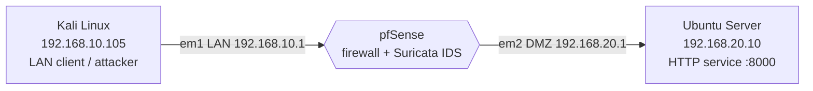

# pfSense + Suricata Network Monitoring Lab

A segmented lab network (**LAN / DMZ behind pfSense**) used to correlate **firewall logs** with **IDS alerts**: a filtering rule with logging on pfSense, **Suricata** in IDS mode with the **Emerging Threats Open** ruleset, and an **Nmap** reconnaissance scan from Kali Linux detected and analysed.

📄 Full report (French): [`pfSense_Suricata_network_monitoring_report.pdf`](pfSense_Suricata_network_monitoring_report.pdf)

> *FR — Supervision réseau et détection d'activités suspectes : pare-feu pfSense (LAN/DMZ), IDS Suricata (ET Open), scan Nmap détecté et corrélé avec les journaux du pare-feu.*

## Architecture



| Machine | IP | Interface | Role |
|---|---|---|---|
| Kali Linux | 192.168.10.105 | eth0 | Client and attacker (LAN) |
| pfSense LAN | 192.168.10.1 | em1 | Gateway for the LAN |
| pfSense DMZ | 192.168.20.1 | em2 | Gateway for the DMZ |
| Ubuntu Server | 192.168.20.10 | enp0s8 | Web server in the DMZ |

## 1. Service in the DMZ

```bash
# Ubuntu (DMZ)
python3 -m http.server 8000 --bind 0.0.0.0

# Kali (LAN) — route to the DMZ through pfSense, then test
sudo ip route add 192.168.20.0/24 via 192.168.10.1 dev eth0
curl -I http://192.168.20.10:8000        # HTTP/1.0 200 OK
```

## 2. Firewall rule and log analysis (pfSense)

| Field | Value |
|---|---|
| Action / interface | Pass on LAN |
| Protocol | TCP |
| Source → destination | LAN subnets → 192.168.20.10:8000 |
| Description | Allow LAN to DMZ HTTP |
| Logging | Enabled |

Logged event:

```
Nov 11 16:03:53 LAN  192.168.10.105:60314 -> 192.168.20.10:8000  TCP:S   (pass)
```

`TCP:S` is the SYN of the connection, allowed by the rule above.

## 3. Intrusion detection (Suricata on pfSense)

| Setting | Value |
|---|---|
| Monitored interface | LAN (em1), promiscuous mode |
| Mode | IDS (detection and logging, **Block Offenders disabled**) |
| Engine profile | Medium, AutoFP |
| Ruleset | ET Open: `emerging-scan`, `emerging-exploit`, `emerging-web_server`, `emerging-web_specific_apps`, `emerging-malware`, `emerging-attack_response` |

Reconnaissance from Kali:

```bash
sudo nmap -sS -sV -p 8000 192.168.20.10
# 8000/tcp open  http  SimpleHTTPServer 0.6
```

Resulting alerts:

| Field | Value |
|---|---|
| Time | 11/11/2026 18:42:44 (4 alerts) |
| Source → destination | 192.168.10.105 → 192.168.20.10:8000 (TCP) |
| Signature | `1:2024364` — **ET SCAN Possible Nmap User-Agent Observed** |
| Category | Web Application Attack |

The `-sV` service probe sends HTTP requests with Nmap's default User-Agent, which the ET signature matches.

## 4. What the lab shows

- **Firewall logs vs IDS alerts:** pfSense says *how* traffic was handled (pass/block); Suricata says *whether it looks malicious*. Each is incomplete alone.
- **Correlation is the hard part:** events live in different consoles, so you match them by time, IP and port by hand — the gap a SIEM fills (see my [ELK SOC Detection Lab](https://github.com/blackswanunagi/elk-soc-detection-lab-PFA)).
- **IDS ≠ IPS:** in this configuration the scan was detected and logged, not blocked.

## Next steps

- Switch Suricata to IPS (inline) mode and verify the scan is blocked.
- Forward pfSense and Suricata (EVE JSON) logs to ELK for automatic correlation.
- Add custom Suricata rules for the lab's own services.

All tests were run in an isolated virtual lab.

**Author:** Hiba El Hjouji — Cybersecurity engineering student, FST Guéliz (Université Cadi Ayyad).
